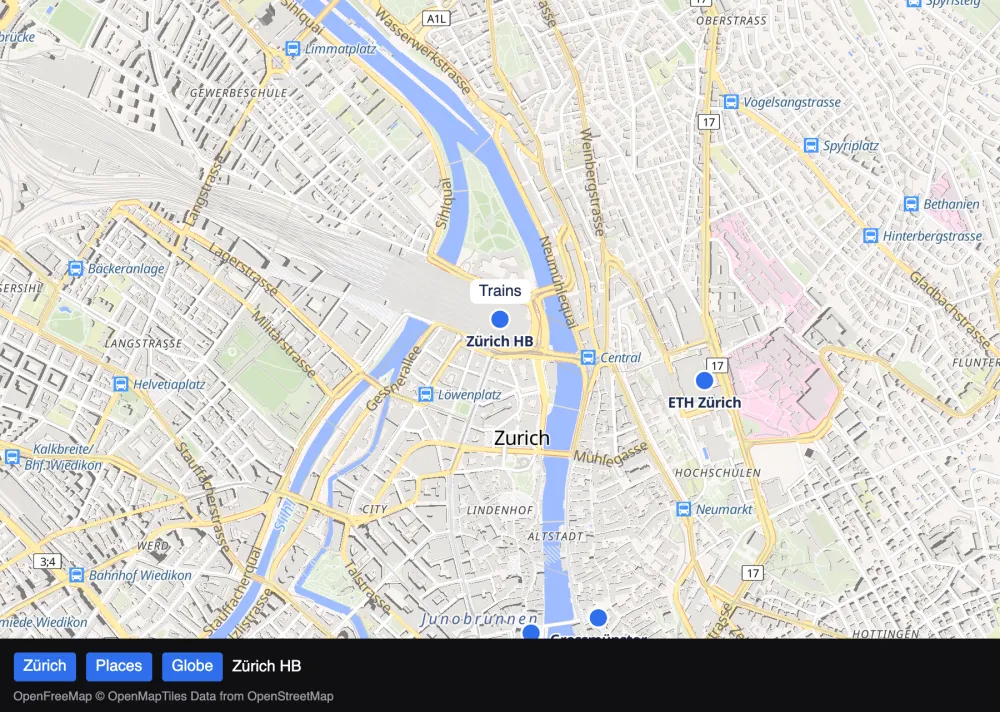

# FerroUI

`maplibre-ferroui` is the map in [FerroUI](https://github.com/wieslawsoltes/FerroUI) apps, drawn by
mln-rs into IOSurfaces that FerroUI's compositor draws as they are. It runs on macOS so far.



The map renders on a thread of its own into a ring of IOSurfaces, with mln-rs's Metal backend. A
`FerroMap` control hands FerroUI's compositor the newest one as the frame of a drawing surface, through
FerroUI's GPU interop, and Skia's Graphite samples it on Metal. Nothing is copied on the way. The
compositor holds each frame until its last GPU read of it completed, and the frame then goes back to
the map. The map composes with the rest of the UI, and FerroUI's controls draw over it, turned with
it if they like. The app declares its map as [the map model](../model.md) has it, sends commands such
as `flyTo` and `fitBounds`, hears of events such as `click`, and reads the map's record. The map takes
the mouse and touches with their modifier keys, the wheel, and a trackpad's pinch and rotation.

It needs FerroUI's Skia on Metal, which a FerroUI app on macOS draws with unless it asks for another
renderer. With another one the map doesn't show, posts an `error` event, and `error()` says why.

## Using it

It builds on FerroUI 0.5.0 from crates.io. It isn't on crates.io itself yet, so an app takes it from
a checkout of this repository, and `cargo doc` in `ferroui` builds its API.

A `FerroMap` is a control that fills the room its layout gives it:

```rust
use maplibre_ferroui::FerroMap;

let map = FerroMap::with_inputs(inputs);
map.on_event(|map, event| {
    // a click's features are in map.record()
});
window().title("Map").child(map.clone())
```

Commands go through the control:

```rust
map.command(fly_to_zurich);
```

FerroUI draws with the Skia that `skia-bindings` 0.153.3 publishes, whose Graphite leaks a little with
each Metal pipeline it makes. FerroUI fixes it with
[a patched binding](https://github.com/wieslawsoltes/FerroUI/blob/main/docs/apps.md#the-graphite-metal-ownership-fix),
which an app that takes FerroUI from crates.io names in its own `[patch.crates-io]`.

## Markers

`marker_places` has where the content's markers at places go, and `on_markers_moved` calls the app
when one moved. `at_marker` holds a control there, a child of a `Canvas` over the map, with its anchor
on the point. FerroUI turns controls, so a marker turns with the map when its content says so.

```rust
// in the content: "markers": {"station": {"lngLat": [8.5402, 47.3779], "anchor": "bottom"}}
map.on_markers_moved(move |map| {
    if let Some(place) = map.marker_places().iter().find(|place| place.name == "station") {
        at_marker(&callout, place);
    }
});

grid().child(map.clone()).child(canvas().child(callout))
```

## Running the example

[`examples/hello-map`](https://github.com/birkskyum/maplibre-rust-ui/tree/main/ferroui/examples/hello-map)
is a map of a few places in Zürich, which a tap names, with buttons that fly there, fit them in view and
turn the globe on, and a callout over the station. It needs mln-rs next to this repository.

```sh
cd maplibre-rust-ui/ferroui
cargo run -p hello-map-ferroui
cargo test -p hello-map-ferroui --test walk -- --ignored   # a short walk out of sight, saved in target/tmp/hello-map-walk
```

The walk runs the app in a window without a frame, far off every screen, which never takes the focus,
while the app has no Dock icon. It saves the window as FerroUI's compositor draws it. The map loads,
flies to Zürich, a click through FerroUI's input names Zürich HB, the wheel zooms in, the places fit
in view and the globe turns on. FerroUI's macOS window takes no more room than its screen has before
it shows, which a window off every screen hasn't, so the walk gives it its size once it shows.
